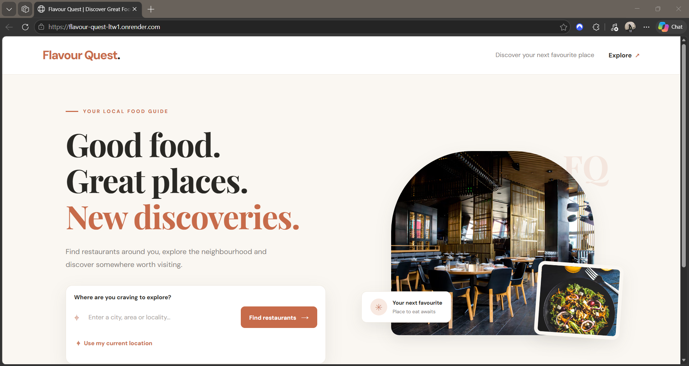
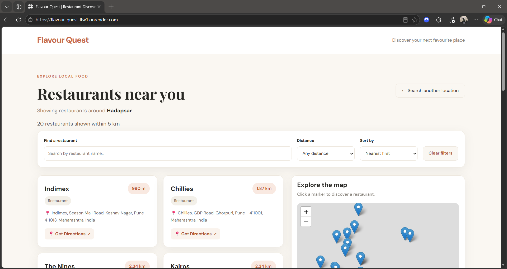
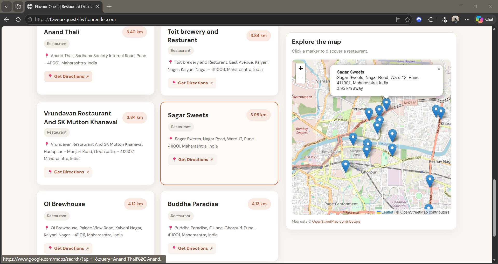

# Flavour Quest

**A location-based restaurant discovery application built with Python, Flask, Geoapify and OpenStreetMap.**

Flavour Quest helps users discover nearby restaurants by searching for a location or using their current location. It retrieves restaurant information through the Geoapify Places API, calculates distances, and displays the results on an interactive map.

The project was originally developed as an individual university project and later modernized to replace outdated API integrations and improve the application's functionality and user experience.

## Live Demo

**Try Flavour Quest:** https://flavour-quest-ltw1.onrender.com

*Note: The application is hosted on Render's free tier. It may take a little longer to respond when starting after a period of inactivity.*

## Screenshots

### Home Page



### Restaurant Results






## Features

- **Location-based search:** Search for restaurants using a manually entered location.
- **Current location detection:** Use browser geolocation to find restaurants near your current position.
- **Restaurant discovery:** Retrieve nearby restaurant information using the Geoapify Places API.
- **Distance calculation:** Calculate the distance between the searched location and each restaurant using the Haversine formula.
- **Distance-based sorting:** Display restaurants from nearest to farthest, with sorting options.
- **Interactive map:** Visualize restaurant locations using Leaflet and OpenStreetMap.
- **Map and card interaction:** Select a restaurant marker to highlight its corresponding card, or select a card to focus on its map marker.
- **Restaurant filtering:** Filter results by restaurant name and distance.
- **Clear filters:** Reset applied filters and restore the results.
- **Responsive interface:** Support desktop and mobile screen sizes.
- **Google Maps navigation:** Open a restaurant's location through a Google Maps search link.

## Technologies Used

| Category | Technologies |
|---|---|
| Backend | Python, Flask |
| Frontend | HTML, CSS, JavaScript, Bootstrap 5 |
| Maps | Leaflet, OpenStreetMap |
| Places API | Geoapify Places API |
| Geocoding | Nominatim (OpenStreetMap) |
| Distance Calculation | Haversine formula |
| Environment Configuration | python-dotenv |
| HTTP Requests | Requests |
| Deployment | Render, Gunicorn |
| Version Control | Git, GitHub |

## How It Works

1. The user enters a location or selects the current-location option.
2. For manual searches, the application uses Nominatim to convert the location into geographic coordinates.
3. For current-location searches, the browser's Geolocation API provides the user's coordinates. Nominatim reverse geocoding is used to obtain a readable address.
4. The Flask backend sends a request to the Geoapify Places API using the coordinates and search radius.
5. Restaurant results are processed, and distances are calculated using the Haversine formula.
6. Results are sorted by distance and displayed as restaurant cards.
7. Leaflet displays restaurant locations on an interactive map.
8. Users can filter, sort and explore the restaurant results.

## Distance Calculation

Flavour Quest uses the **Haversine formula** to calculate the straight-line distance between two geographic coordinates on Earth.

This calculation is useful for comparing the geographic proximity of restaurants to the searched location.

**Important:** The calculated distance represents straight-line distance, not actual road or travel distance. Road distances may differ from the distances shown by navigation applications such as Google Maps.

## Getting Started

Follow these steps to run Flavour Quest locally.

### Prerequisites

- Python 3.10 or later
- Git
- A Geoapify API key

### 1. Clone the Repository

```bash
git clone https://github.com/SayleeMJ/Flavour-Quest.git
cd Flavour-Quest
```

### 2. Create a Virtual Environment

```bash
python -m venv .venv
```

Activate the environment:

**Windows PowerShell**

```powershell
.venv\Scripts\Activate.ps1
```

**macOS / Linux**

```bash
source .venv/bin/activate
```

### 3. Install Dependencies

```bash
pip install -r requirements.txt
```

### 4. Configure Environment Variables

Create a `.env` file in the root directory:

```env
GEOAPIFY_API_KEY=your_geoapify_api_key
```

Replace `your_geoapify_api_key` with your own API key.

You can obtain an API key from [Geoapify](https://www.geoapify.com/).

### 5. Run the Application

```bash
python app.py
```

Open your browser and visit:

```text
http://127.0.0.1:5000/
```

## Project Structure

```text
Flavour-Quest/
│
├── static/
│   ├── index.css
│   └── styles.css
│
├── templates/
│   ├── index.html
│   ├── restaurants.html
│   └── error.html
│
├── app.py
├── requirements.txt
├── .env                  # Local environment variables
├── .gitignore
├── Dockerfile
└── README.md
```

## External Services and APIs

| Service | Purpose |
|---|---|
| Geoapify Places API | Retrieve nearby restaurant information |
| Nominatim | Convert location names into coordinates and perform reverse geocoding |
| OpenStreetMap | Provide map tile data |
| Browser Geolocation API | Retrieve the user's current geographic coordinates |
| Google Maps | Provide external navigation/search links for restaurants |

## Limitations

- Restaurant information depends on the availability and coverage of the Geoapify Places API and its underlying data sources.
- Some restaurant details, such as ratings, reviews, phone numbers, opening hours, menus and images, may not be available.
- Location accuracy depends on the geocoding service and the information entered by the user.
- Haversine calculations provide straight-line distances rather than road distances.
- Current-location detection requires browser permission and an appropriate secure context (HTTPS, or localhost during local development).
- The live application uses Render's free tier, so initial requests after inactivity may experience a delay.
- External API availability, request limits and response times can affect application performance.

## Future Improvements

Potential enhancements include:

- More detailed restaurant information.
- Additional restaurant categories and search filters.
- Improved restaurant data enrichment.
- Better handling of API failures and loading states.
- Performance improvements and more efficient API request handling.
- Additional automated tests.

These are potential improvements and should not be interpreted as currently implemented features.

## Project Background

Flavour Quest began as an individual university project focused on restaurant discovery using location-based services.

The modernization work focused on updating the application's external API integrations, improving restaurant discovery, enhancing map interactions, refining the user interface, and deploying the application as a live web service.

This project demonstrates practical experience with:

- Python and Flask application development.
- REST API integration.
- Geocoding and geographic coordinates.
- Distance calculation using the Haversine formula.
- Frontend and backend integration.
- Interactive maps and location-based functionality.
- Environment variable management.
- Git/GitHub version control.
- Web application deployment.

---

**Developed and modernized by [SayleeMJ](https://github.com/SayleeMJ)**

